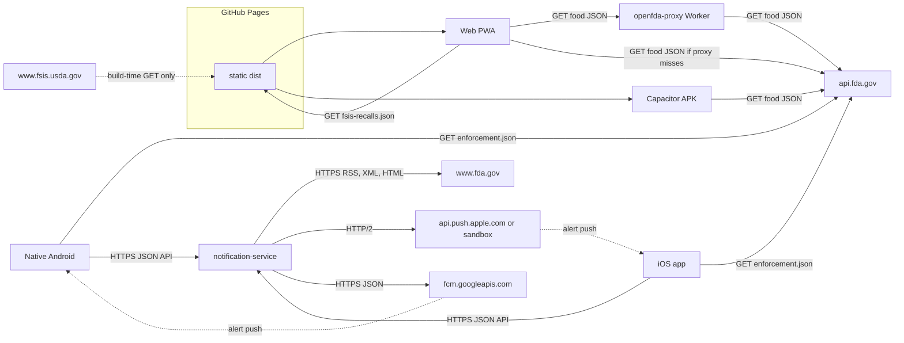
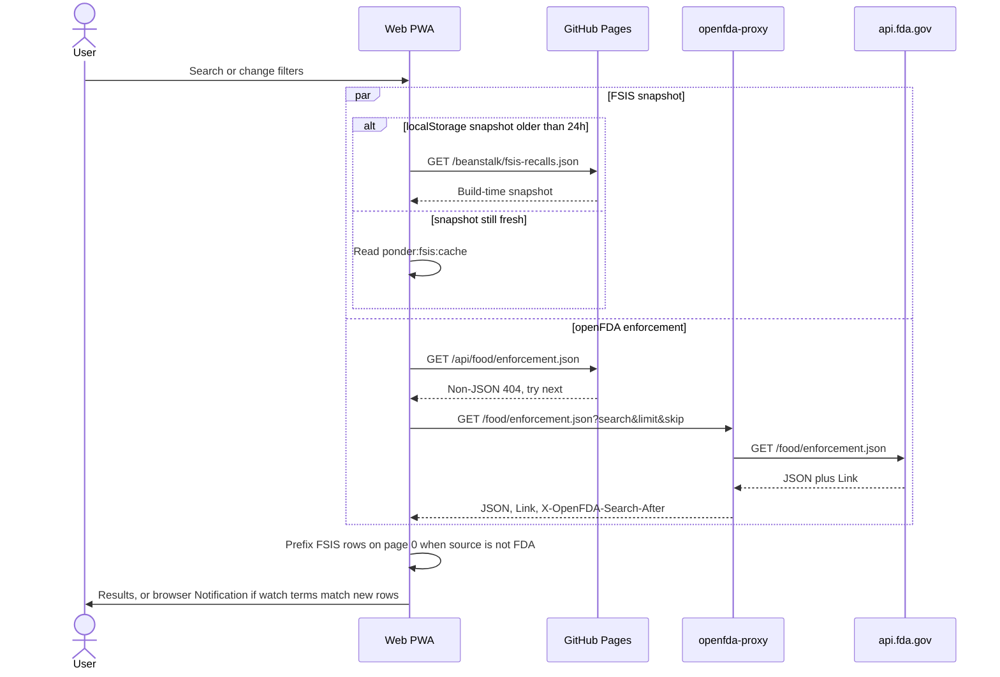
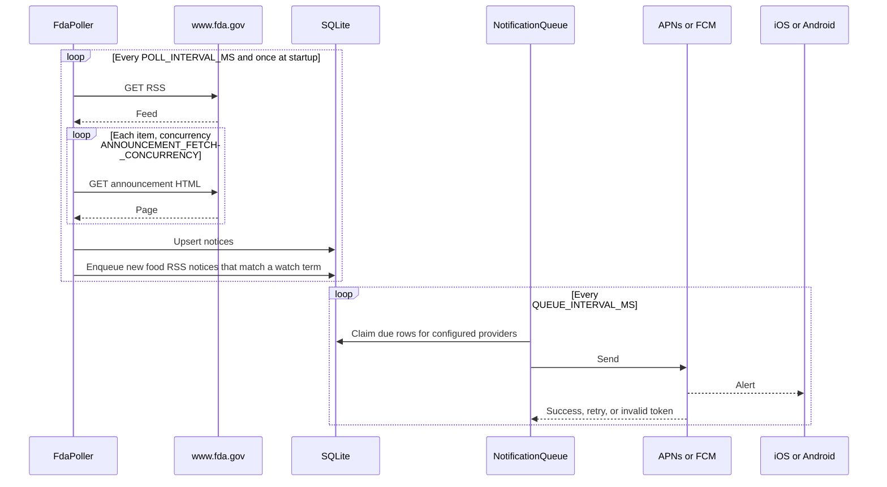

# Beanstalk architecture

This note describes the tree on `main`: what each program does, which hosts it calls, and what it stores. It is taken from source and config. Where a README disagrees with the code, the code is the source of truth and the disagreement is called out. Nothing here asserts that a hostname is live in production unless a workflow or compose file in this repository binds it.

## Components

| Piece | What the tree actually builds |
| --- | --- |
| Web PWA | Vite + React app in `food-recall-app/`. `npm run build` is `fetch:fsis`, then `tsc --noEmit`, then `vite build` (`food-recall-app/package.json`). |
| GitHub Pages | `.github/workflows/pages.yml` builds that app on a push to `main` that touches `food-recall-app/**` or the workflow, and deploys `food-recall-app/dist` with `actions/deploy-pages`. The workflow comment states the public URL `https://jacobrakaifoundation.github.io/beanstalk/`. The default Vite base is `/beanstalk/` (`food-recall-app/vite.config.ts`). |
| openFDA proxy | Cloudflare Worker in `openfda-proxy/`. It is not one of the six clients, and no workflow in this repo deploys it. The Pages build hardcodes its `workers.dev` origin (see below). |
| Capacitor sideload APK | `android-apk/` wraps the same Vite build. `npm run build:android` sets `VITE_BASE=/`, runs the web build, then `npx cap sync android` (`food-recall-app/package.json`, `food-recall-app/capacitor.config.json`). CI job `android sideload apk` uploads `beanstalk-debug-apk` (`.github/workflows/ci.yml`). |
| Native Android | Separate Compose app in `android/`. CI job `android native assemble` uploads `beanstalk-native-debug-apk`. |
| iOS | SwiftUI app in `ios/`, bundle id `org.jacobrakaifoundation.beanstalk`, deployment target iOS 17 (`ios/project.yml`). |
| notification-service | Node 22 Fastify process in `notification-service/`. It is the only server the native apps call for notices and device registration. |

The native Android application id and the Capacitor `appId` are both `org.jacobrakaifoundation.beanstalk` (`android/app/build.gradle.kts`, `food-recall-app/capacitor.config.json`). The two APKs are different programs that would claim the same package name.

Dotted edges are not on the request path of a running client. The FSIS API is fetched while `npm run build` writes `public/fsis-recalls.json`. Push edges run only after a device is registered and the matching provider credentials are present. With the flags in this tree, registration does not start. See [Build flags](#build-flags).

## How data moves

There are three separate recall paths. They do not share a database.

**Historical enforcement search** reads openFDA `food/enforcement.json`. The web app and the Capacitor wrap use the browser `fetch` in `food-recall-app/src/lib/api.ts`. Native Android uses OkHttp in `BeanstalkApi.enforcement`. iOS uses `URLSession` in `APIClient.enforcementRecords`, with the URL built by `OpenFDARequestBuilder`. None of those clients send the result to notification-service. The service README and `notification-service/src/queue.ts` both refuse to alert from anything except an RSS-sourced food notice.

**USDA FSIS** exists only in the web app. Native Android and iOS have no FSIS client. A production web or APK build does not call USDA from the phone or the browser. `food-recall-app/scripts/fetch-fsis-recalls.ts` downloads the FSIS recall API at build time and writes `food-recall-app/public/fsis-recalls.json`. That file is gitignored (`food-recall-app/.gitignore`). The running app then `fetch`es the static file from its own origin. `vite dev` is the exception: it proxies `/api/fsis-recalls` to USDA (`food-recall-app/vite.config.ts`).

**Alerts** start in notification-service. It polls an FDA RSS feed, fetches each linked announcement page on `www.fda.gov`, stores notices in SQLite, and matches them to device watch terms. Delivery is APNs or FCM. The web PWA does not call this service. Its "notifications" are the browser `Notification` constructor after a search, in `food-recall-app/src/App.tsx` and `food-recall-app/src/lib/notifications.ts`.

The web app also searches openFDA `food/event.json` (CAERS) for the Early Signals tab and for related events on a recall card (`food-recall-app/src/lib/events.ts`). That dataset is not used by the native apps or by notification-service.

## Outbound network calls

"Programmatic" means the process issues the request. "User opens" means a link or share action. No component in this tree sends an analytics, advertising, or error-reporting request. `workbox-google-analytics` appears only as a transitive dependency of Workbox in `food-recall-app/package-lock.json`. `food-recall-app/vite.config.ts` does not enable it.

### Web PWA and the Capacitor wrap

Both run the same JavaScript. The wrap copies `dist/` into a WebView (`food-recall-app/capacitor.config.json` sets `webDir` to `dist` and `server.androidScheme` to `https`, and does not set `server.url` or `server.hostname`). It adds no Kotlin networking of its own. `android-apk/app/src/main/AndroidManifest.xml` declares `INTERNET` and `POST_NOTIFICATIONS`.

openFDA candidate order is fixed in `openFdaCandidateUrls` (`food-recall-app/src/lib/openfdaPaging.ts`):

1. `{window.location.origin}/api/food/{enforcement|event}.json` when `window` exists and the origin is not `"null"`.
2. `{VITE_OPENFDA_PROXY}/food/{enforcement|event}.json` when that variable is non-empty after trimming a trailing slash.
3. `https://api.fda.gov/food/{enforcement|event}.json`.

A candidate is skipped when the response is HTTP 200 with a non-JSON content type, or HTTP 404 with a non-JSON content type, and another candidate remains. The Pages site is served under `/beanstalk/`, but candidate 1 uses the origin root, so it asks for `https://jacobrakaifoundation.github.io/api/food/...`, which this app does not publish. On the Capacitor WebView the origin is whatever the WebView reports. This repo does not set it.

`DEFAULT_OPENFDA_PROXY` (`https://beanstalk-openfda.jacob-e-durham.workers.dev`) is not a runtime fallback. `openFdaProxyBase()` returns null when `VITE_OPENFDA_PROXY` is unset. The Pages workflow sets that variable. `npm run build:android` and the sideload CI job do not, so the sideload APK skips the Worker and uses `api.fda.gov` after the same-origin miss.

| When | Protocol and host | What is sent | Auth |
| --- | --- | --- | --- |
| Each non-demo recall search, filter change, or page change (`food-recall-app/src/App.tsx`) | `GET` HTTPS to the candidates above, `food/enforcement.json` | Query string: `limit`, `sort=report_date:desc`, `skip` or `search_after`, and `search` built from classification, status, state, dietary terms, hazard category, and the typed query (`food-recall-app/src/lib/api.ts`). No body. Abort after 8 seconds. | No `Authorization` header and no `api_key` from the client. |
| Early Signals tab, and related events on a recall detail | Same candidates, `food/event.json` | `limit`, `sort=date_started:desc`, `skip` or `search_after`, and a `search` over brand, reactions, and outcomes, or up to eight brand tokens for related events (`food-recall-app/src/lib/events.ts`). | Same. None. |
| FSIS snapshot older than 24 hours, or missing (`ponder:fsis:cache`) | Production and APK: `GET` the same origin `{BASE_URL}fsis-recalls.json`. `vite dev`: `GET /api/fsis-recalls`, which the dev server proxies to `https://www.fsis.usda.gov/fsis/api/recall/v/1`. | No query string in app code. | None. |
| Pages past `skip` 25000 without a stored cursor | Extra `GET`s that walk `search_after` in hops of at most 1000 (`bootstrapSearchAfterCursor`). | Same search, changing cursor. | None. |
| `?demo=1`, `?demo=true`, `localStorage` `ponder:demo=1`, or `VITE_DEMO=true` | No fetch. Mock rows in `food-recall-app/src/lib/mockData.ts` and `mockEvents.ts`. | | |
| User turns on in-page alerts | No network. `Notification.requestPermission` and `new Notification` (`food-recall-app/src/lib/notifications.ts`). | Title and body stay on the device. Seen record ids live in a React ref, not storage, so a reload can notify again. | |

The 6-hour openFDA `localStorage` cache is written after a successful response and read only when a later request fails. A fresh cache entry does not skip the network (`getCacheEntry` in `food-recall-app/src/lib/api.ts`).

`VITE_OPENFDA_KEY` is declared in `food-recall-app/src/vite-env.d.ts` and is not read by any client fetch. The Vite dev proxy injects `OPENFDA_API_KEY` or `VITE_OPENFDA_KEY` as `api_key` on `/api/food` only (`food-recall-app/vite.config.ts`). That proxy does not exist in `vite build` output.

User-opened links, not automatic fetches: `https://api.fda.gov` record URLs, `https://www.accessdata.fda.gov/scripts/ires/index.cfm` (`food-recall-app/src/components/RecallDetail.tsx`), `https://www.fda.gov` CAERS and recall pages, `https://www.fsis.usda.gov/recalls`, `https://open.fda.gov` API docs, `https://jacobrakai.org`, and `https://github.com/jacobrakaiFoundation/beanstalk` (`food-recall-app/src/App.tsx`, `food-recall-app/index.html`, `food-recall-app/public/*.html`). An FSIS card also opens `field_recall_url` from the snapshot when it is `http:` or `https:`.

The generated service worker precaches `js`, `css`, `html`, `svg`, `png`, and `ico` from the same origin (`workbox.globPatterns` in `food-recall-app/vite.config.ts`). It is not configured here to cache openFDA responses.

### openFDA proxy

`openfda-proxy/src/index.js` accepts `GET`, `HEAD`, and `OPTIONS` for `/food/enforcement.json` and `/food/event.json` only. It forwards the query string to `https://api.fda.gov` and drops any inbound `api_key`. If the Worker env `OPENFDA_API_KEY` is set, it adds that key on the upstream URL. The response gets `Access-Control-Allow-Origin: *`, exposes `Link` and `X-OpenFDA-Search-After`, rewrites `Link` onto the Worker origin, and sets `Cache-Control: public, max-age=60`. Upstream request header is `Accept: application/json`. No other host is named in this file.

`openfda-proxy/wrangler.jsonc` sets the Worker name `beanstalk-openfda` and `workers_dev: true`. It has no custom-domain route. `openfda-proxy/README.md` says the deployed origin is `https://beanstalk-openfda.jacob-e-durham.workers.dev`. That string is also the Pages build env in `.github/workflows/pages.yml`. This repository has no workflow that runs `wrangler deploy`.

### Build machine, web and APK only

`food-recall-app/scripts/fetch-fsis-recalls.ts` runs as part of `npm run build`, including Pages and the sideload job.

| When | Protocol and host | What is sent | Auth |
| --- | --- | --- | --- |
| Once per web or APK build | `GET` `https://www.fsis.usda.gov/fsis/api/recall/v/1` | Header `User-Agent: Beanstalk-FoodRecall/1.0 (build script)`. Timeout 60 seconds. | None. |

A non-200, a non-JSON body, or a thrown fetch writes an empty snapshot with an `error` string and still exits 0, so the rest of the build continues. Archived rows are dropped. `--recalls-only` also drops records whose `field_recall_type` is `Public Health Alert`. The Pages and sideload workflows do not pass that flag.

### Native Android

OkHttp timeouts are 15 seconds connect and 15 seconds read (`android/app/src/main/java/org/jacobrakaifoundation/beanstalk/data/network/BeanstalkApi.kt`). Base URL is the build-config field `BACKEND_BASE_URL`, set to `https://api.beanstalk.jacobrakai.org` in `android/app/build.gradle.kts`. Enforcement calls ignore that base and use `https://api.fda.gov/food/enforcement.json`.

| When | Protocol and host | What is sent | Auth |
| --- | --- | --- | --- |
| Recall notice list or detail | `GET` `{BACKEND_BASE_URL}/v1/notices` or `/v1/notices/{id}` | `limit` (1–100), optional `query` (sanitized, max 120), optional `cursor`. | None. |
| Historical search | `GET` `https://api.fda.gov/food/enforcement.json` | `limit` (1–100), `skip` (`page * limit`, refused above 25000), `sort=report_date:desc`, optional `search` of classification, status, and a phrase over product, reason, and firm. No state, dietary, or hazard filter. No `search_after`. | None. |
| User turns alerts on, and only if `FirebaseApp` is already initialized | `POST` `{BACKEND_BASE_URL}/v1/devices` | JSON `provider: "fcm"`, `pushIdentifier` from `FirebaseMessaging.getInstance().token`, `identifierKind: "token"`. | None on create. Response `deviceId` and `clientSecret` are stored. |
| Token refresh for an existing registration | `PUT` `/v1/devices/me/token` | Same JSON body. | `Authorization: Bearer {deviceId}.{clientSecret}`. |
| Watchlist changed while registered | `PUT` `/v1/devices/me/watchlist` | JSON `terms`, the local normalized strings. | Same bearer. |
| User turns alerts off | `DELETE` `/v1/devices/me` | Empty body. | Same bearer. |
| User taps "Open openFDA source" or "Open FDA source" | Android view of `EnforcementRecord.sourceURL` (`api.fda.gov`) or `RecallNotice.sourceURL` (whatever the service stored, normally `www.fda.gov`) | | |

`BeanstalkApi` does not call FSIS, the Worker, or Apple.

Firebase Messaging is a Gradle dependency (`android/app/build.gradle.kts`). The hosts it would use are not named in this repository. The checked-in manifest removes `FirebaseInitProvider`, `FirebaseMessagingService`, and `FirebaseInstanceIdReceiver`, and sets `firebase_messaging_auto_init_enabled`, `firebase_analytics_collection_enabled`, and `firebase_data_collection_default_enabled` to false (`android/app/src/main/AndroidManifest.xml`). `google-services.json` is gitignored (`android/.gitignore`) and is not in the tree. `NotificationCoordinator` treats push as unavailable unless `FirebaseApp.getApps` is non-empty, so the device routes above do not run for a build of this tree. The token call, if it ever ran, would be the Firebase SDK's own traffic plus the JSON calls in the table.

### iOS

`URLSession.shared` is used with no timeout set in app code (`ios/App/Networking/APIClient.swift`, `ios/App/Networking/DeviceAPI.swift`). Backend base is Info.plist `BEANSTALK_BACKEND_BASE_URL`, which is `https://api.beanstalk.jacobrakai.org` (`ios/App/Info.plist`). `AppConfiguration` falls back to that same URL if the plist string is missing or not a URL.

| When | Protocol and host | What is sent | Auth |
| --- | --- | --- | --- |
| Notice list or detail | `GET` `{base}/v1/notices` or `/v1/notices/{id}` | `limit` (1–100, caller default 30), optional `cursor`, optional `query` (max 120). | None. Notice detail is a plain `GET`. Device calls set `cachePolicy` to reload and ignore local URL cache. |
| Historical search | `GET` `https://api.fda.gov/food/enforcement.json` | Same shape as Android: `search`, `limit`, `skip`, `sort=report_date:desc`. Skip above 25000 throws before the request. HTTP 404 becomes an empty page. | None. |
| Alerts enabled and `BEANSTALK_PUSH_CONFIGURED` is true | `POST` `{base}/v1/devices` | JSON `deviceToken` (hex APNs token) and `environment` (`production` only if Info.plist `APNS_ENVIRONMENT` is the string `production`, otherwise `sandbox`). | None on create. |
| Stored credentials exist | `PUT` `/v1/devices/me/token` with the same body, then `PUT` `/v1/devices/me/watchlist` with `terms` | | `Authorization: Bearer {deviceID}.{clientSecret}`. |
| Sync or verify | `GET` `/v1/devices/me` | | Same bearer. |
| Disable | `DELETE` `/v1/devices/me` | | Same bearer. |
| User opens a link | `www.fda.gov` recall index, `www.fsis.usda.gov/recalls`, the notice `sourceURL`, the synthesized openFDA `sourceURL`, `jacobrakaifoundation.github.io` privacy and support pages, `https://jacobrakai.org/donate/` (`ios/App/Views/SettingsView.swift`, detail views) | | |

`BEANSTALK_PUSH_CONFIGURED` is `false` in `ios/App/Info.plist`. `AlertControlPolicy.isPushConfigured` treats missing, false, and any string other than `1`, `true`, or `yes` as off. `NotificationRegistrationService` then does not call `registerForRemoteNotifications` or `DeviceAPI`. The device rows in the table are present in code and inactive in this tree.

`aps-environment` is `$(APNS_ENVIRONMENT)` (`ios/App/Beanstalk.entitlements`). XcodeGen sets that build setting to `development` for Debug and `production` for Release (`ios/project.yml`). Those are Apple entitlement values. The string sent to notification-service is a different vocabulary: only `production` stays `production`, and `development` becomes `sandbox` (`ios/App/AppConfiguration.swift`).

Registering for remote notifications is an Apple API. This repo does not name an APNs host in the iOS client. The service is the component that opens a connection to Apple.

### notification-service

The process listens on `HOST` and `PORT` (`notification-service/src/config.ts`, `notification-service/src/index.ts`). It does not contain the string `api.beanstalk.jacobrakai.org`. Clients assume that name. This repo does not contain DNS, TLS, or tunnel config that attaches it.

FDA fetches require `https`, host `fda.gov` or `www.fda.gov`, no userinfo, and no explicit port (`validatedFdaHttpsUrl` in `notification-service/src/sources.ts`). Redirects are followed manually, at most four, and each target is checked again. Header `user-agent` is `BeanstalkRecallService/0.1 (+https://jacobrakai.org/)`. The `jacobrakai.org` token is only inside that header. The service does not request that site.

| When | Protocol and host | What is sent | Auth |
| --- | --- | --- | --- |
| Startup, then every `POLL_INTERVAL_MS` (code default 15 minutes, minimum 60 seconds) | `GET` the RSS URL. Code default `https://www.fda.gov/about-fda/contact-fda/stay-informed/rss-feeds/food-safety-recalls/rss.xml`. Override `FDA_RSS_URL`, still subject to the host check. | `accept: application/xml, text/xml`. Cap 5 MB, timeout 30 seconds. | None. |
| Same poll, after the RSS parse | `GET` each linked announcement page on `fda.gov` | `accept: text/html, application/xhtml+xml`. Cap 5 MB, timeout 15 seconds. Concurrency `ANNOUNCEMENT_FETCH_CONCURRENCY` (default 4, max 8). | None. |
| Only when the previous RSS cursor is missing from the new feed | `GET` each URL in `FDA_ANNUAL_XML_URLS` (or legacy `FDA_ANNUAL_XML_URL`). Code default `https://www.fda.gov/media/191968/download?attachment=`. At most two URLs. | XML accept header. Cap 50 MB each, timeout 30 seconds. | None. |
| `node dist/reenrich.js <limit>` | Same announcement `GET`s for up to 500 stored RSS notices (`notification-service/src/reenrich.ts`) | | None. Does not enqueue alerts. |
| Queue tick, startup and every `QUEUE_INTERVAL_MS` (default 5 seconds, minimum 1 second), when that provider's credentials exist | APNs: HTTP/2 `POST` `https://api.push.apple.com/3/device/{token}` or `https://api.sandbox.push.apple.com/3/device/{token}` (`notification-service/src/apns.ts`) | JSON `aps.alert` title and body from the notice (title max 100 chars, body from reason or summary max 170), `thread-id` `recall-notices`, plus `noticeId`, `matchedTerm`, `matchedField`. Headers: `apns-topic` bundle id, `apns-push-type: alert`, `apns-priority: 10`, `apns-expiration` one hour out. Session timeout 15 seconds. | `authorization: bearer` plus an ES256 JWT. `iss` is `APNS_TEAM_ID`, `kid` is `APNS_KEY_ID`, signed with `APNS_PRIVATE_KEY` or the file at `APNS_PRIVATE_KEY_PATH`. The JWT is cached 50 minutes. |
| Same queue tick for FCM devices, when FCM credentials exist | `POST` `https://fcm.googleapis.com/v1/projects/{FCM_PROJECT_ID}/messages:send` | JSON message. Target is `fid` or `token` from the stored identifier kind. Notification title and body are the fixed strings in `notification-service/src/fcm.ts`, not the notice text. `data` is only `noticeId`. Android priority `HIGH`, ttl `3600s`, collapse key and tag `recall-{noticeId}`, `restricted_package_name` from `FCM_ANDROID_PACKAGE_NAME`, channel `recall_matches`. Timeout 15 seconds. | `Authorization: Bearer` plus the access token from `google-auth-library` `GoogleAuth`, scope `https://www.googleapis.com/auth/firebase.messaging`, key file `FCM_SERVICE_ACCOUNT_PATH` or `GOOGLE_APPLICATION_CREDENTIALS`. The token URL is inside that library. It is not hardcoded in this repo. |

`notification-service/README.md` says existing announcement pages are not fetched again on the 15-minute poll. `FdaPoller.enrich` fetches an announcement for every item in the current RSS document on seed, on a normal poll, and on gap reconciliation (`notification-service/src/poller.ts`). The annual XML is the call that is skipped unless the cursor disappeared.

If any required provider field is missing, that sender is the disabled implementation and the queue does not claim rows for that provider (`notification-service/src/apns.ts`, `notification-service/src/fcm.ts`, `notification-service/src/queue.ts`). `/healthz` is HTTP 200 with `pushDisabled: true` and `status: "degraded"` when neither provider is configured, and HTTP 503 when polling is uninitialized, stale, gap-paused, failing, or recent permanent push failures exist (`notification-service/src/app.ts`).

Public routes `GET /healthz`, `GET /v1/notices`, and `GET /v1/notices/:id` have no bearer check. Device routes use `Authorization: Bearer {deviceId}.{clientSecret}`. The secret is 32 random bytes, base64url. SQLite stores `SHA-256(deviceId + "." + secret)`, not the secret (`notification-service/src/devices.ts`). Global rate limit is 120 requests per minute per client address. `POST /v1/devices` is 10 per minute. `TRUST_PROXY` is how many proxy hops may supply that address (code default 0). The service does not log the authorization header, device token, or client secret (`notification-service/src/app.ts`).

The Android client always sends `identifierKind: "token"`. The service also accepts `"fid"`. The service README describes `fid` as the current Android target and `token` as a transition input. The Android source in this tree sends `token`.

### GitHub Pages hosting

The Pages workflow's own network is GitHub Actions checking out the repo, installing npm packages, and uploading the Pages artifact. At build time the job also performs the FSIS `GET` above, because `npm run build` includes `fetch:fsis`. The workflow sets `VITE_OPENFDA_PROXY` to the `workers.dev` origin and does not set `OPENFDA_API_KEY` or `VITE_OPENFDA_KEY`. Published pages are static files. A browser then makes the web calls in the table above.

`pages.yml` does not run on pull requests. It runs on push to `main` for the paths listed at the top of this note, or `workflow_dispatch`.

## Recall search

This is the GitHub Pages path, which is the build that sets the proxy. Native search is the shorter path in the Android and iOS tables: straight to `api.fda.gov` for enforcement, and to the notification service for FDA notices. Native apps do not merge FSIS.

Page 0 with the source filter left on All is the only page that inserts FSIS rows in front of the FDA page. `total` stays the FDA count (`mergeOpenFdaWithFsis` in `food-recall-app/src/lib/api.ts`). Source `USDA-FSIS` skips openFDA and pages the cached snapshot in the client. Source `FDA` skips FSIS.

## Alert

The first successful poll stores the current RSS items with `eligibleForAlert` false and does not enqueue (`FdaPoller.seed`). Later polls enqueue only canonical URLs that were not already stored. Annual XML rows are stored with alerts disabled. A notice alerts only when it is food, `sourceKind` is `rss`, and `eligibleForAlert` is set (`notification-service/src/queue.ts`). Match fields are title, summary, product, reason, company, distribution, and code info, on Unicode letter and number boundaries (`notification-service/src/domain.ts`). One queue row exists per notice and device. A notice whose publication time is missing, in the future, or more than 24 hours old is canceled rather than sent.

What the phone receives depends on the provider. APNs gets the notice title, a short reason or summary, `noticeId`, `matchedTerm`, and `matchedField`. FCM gets a fixed title and body and `data.noticeId` only. The queue still stores `matched_term` and `matched_field` for both. iOS reads those keys in `BeanstalkAppDelegate`. Android's FCM data payload, as built in `notification-service/src/fcm.ts`, has no match fields to read.

Device registration is not in the diagram because the current flags do not start it. When they do, the phone `POST`s `/v1/devices`, stores the returned secret, and `PUT`s `/v1/devices/me/watchlist`. iOS sends an APNs token. Android sends an FCM registration token with `identifierKind` `"token"`.

## Local storage

### Web PWA and Capacitor WebView

`localStorage` keys written by app code:

| Key | Contents |
| --- | --- |
| `ponder_watchlist` | JSON array of strings (`food-recall-app/src/lib/watchlist.ts`). Not sent anywhere. |
| `ponder_dark_mode` | `"true"` or `"false"` (`food-recall-app/src/hooks/useDarkMode.ts`). |
| `notificationsEnabled` | `"true"` or `"false"`. Gates the local `Notification` call. |
| `ponder:demo` | `"1"` forces demo mode. |
| `ponder:openfda:cache` | Up to 20 openFDA recall pages, 6-hour stale-fallback TTL. |
| `ponder:openfda:lastSynced` | ISO timestamp of the last cache write. |
| `ponder:openfda:event:cache` | Same shape for CAERS events. |
| `ponder:openfda:event:lastSynced` | ISO timestamp. |
| `ponder:fsis:cache` | `{ data, timestamp }` for the FSIS snapshot, 24-hour TTL, and this one does skip the network while fresh. |

No application source uses IndexedDB, `sessionStorage`, or cookies. The Workbox precache uses the browser Cache Storage for static assets. The `ponder` prefix is what the code writes. This tree does not explain the name.

### Native Android

SQLite file `beanstalk.sqlite`, version 3 (`android/app/src/main/java/org/jacobrakaifoundation/beanstalk/data/local/BeanstalkDatabase.kt`):

| Table | Contents |
| --- | --- |
| `saved_recalls` | Saved notice or enforcement JSON, title, subtitle, kind, timestamp. |
| `watch_terms` | Normalized term and created time. Cap 20 terms, each 2–80 characters, enforced in `BeanstalkRepository`. |
| `cache_entries` | SHA-256 cache key, JSON payload, time. At most 200 rows, dropped after 30 days. Served when a network call throws. |
| `sync_state` | `watchlist_revision` and `watchlist_acknowledged_revision`. |

Device credentials live in SharedPreferences file `encrypted_device_credentials`, ciphertext plus IV, encrypted with an Android Keystore AES/GCM key `beanstalk_device_credentials_v1` (`SecureCredentialStore.kt`). The plaintext JSON is `deviceId`, `clientSecret`, and `pushIdentifier`.

### iOS

SwiftData models `SavedRecallItem` and `WatchTermEntity` (`ios/App/Models/PersistenceModels.swift`, container in `ios/App/BeanstalkApp.swift`). Saved payloads are encoded notices or enforcement records.

Keychain service `org.jacobrakaifoundation.beanstalk.notifications` (`ios/App/Networking/DeviceAPI.swift`, `KeychainStore.swift`):

| Account | Contents |
| --- | --- |
| `device-credentials` | JSON `deviceID` and `clientSecret`. |
| `apns-token` | Hex device token. |
| `alerts-enabled` | `true` or `false`. |

Last successful notice and enforcement responses are JSON files under Application Support `Beanstalk/LastSuccessfulResults`, falling back to the temp directory (`APIClient.swift`). On a network error the client returns them even when older than 6 hours (`allowExpired: true`). A one-item file `Beanstalk/pending-notification.json` holds a notification tap that arrived before the UI subscribed (`ios/Core/Sources/BeanstalkCore/PendingNotificationBuffer.swift`).

### notification-service

SQLite at `DATABASE_PATH` (code default `./data/beanstalk-notifications.sqlite`, Compose sets the path inside `/data`). Tables from `notification-service/src/database.ts`: `schema_migrations`, `notices`, `devices` (token or FID, provider, environment, secret hash, active flag), `watch_terms`, `delivery_queue`, `poll_state`.

Startup and a 24-hour timer delete delivery rows older than `DELIVERY_RETENTION_DAYS` (code default 30) and inactive devices older than that same cutoff. Active devices and notice rows are kept. `scripts/backup.sh` and `scripts/restore.sh` copy that file. Restore marks devices `restored_quarantine` and cancels queued deliveries. Those scripts read `DATABASE_PATH`, `BACKUP_DIRECTORY`, and `BACKUP_RETENTION_DAYS`.

## notification-service deployment

There is no deploy workflow. The files that describe deployment are:

- `notification-service/Dockerfile` builds a Node 22 image, sets `NODE_ENV` to production inside the image, drops to user `node`, and runs `node dist/index.js`.
- `notification-service/docker-compose.yml` builds that image, reads an optional `.env`, sets `HOST` and `DATABASE_PATH` in the compose `environment` block, publishes `127.0.0.1:8787` only, mounts a named volume on `/data` and `./secrets` read-only on `/run/secrets`, uses a read-only root filesystem, and healthchecks `GET http://127.0.0.1:8787/healthz` every 30 seconds.
- `notification-service/deploy/beanstalk-notifications.service` is an optional systemd unit whose working directory is `/opt/beanstalk/notification-service` and whose start command is `docker compose up`.

`notification-service/README.md` calls this the Malachi deployment and says an existing HTTPS proxy or tunnel should be the public listener. No proxy config is in the repository, so the public hostname is not established here. `.env.example` shows the variable names operators are expected to set. Values are not copied into this document.

### Environment variables by name

Read by the server process (`notification-service/src/config.ts`, `notification-service/src/app.ts`):

| Name | Role |
| --- | --- |
| `HOST` | Bind address. Code default is the IPv4 loopback. Compose overrides it. |
| `PORT` | Bind port. Code default 8787. |
| `DATABASE_PATH` | SQLite file. |
| `FDA_RSS_URL` | RSS document. Empty means the code default on `www.fda.gov`. |
| `FDA_ANNUAL_XML_URLS` | Comma-separated annual XML URLs, one or two. |
| `FDA_ANNUAL_XML_URL` | Legacy single-URL alias if `FDA_ANNUAL_XML_URLS` is unset. |
| `POLL_INTERVAL_MS` | Pause between polls. |
| `QUEUE_INTERVAL_MS` | Pause between delivery batches. |
| `DELIVERY_RETENTION_DAYS` | Age for pruning deliveries and inactive devices. |
| `POLL_STALE_AFTER_MS` | `/healthz` staleness window. |
| `ANNOUNCEMENT_FETCH_CONCURRENCY` | Parallel announcement fetches. |
| `LOG_LEVEL` | Fastify log level. Code default `info`. |
| `TRUST_PROXY` | Proxy hop count for the client address. Code default 0. |
| `APNS_TEAM_ID` | JWT issuer. All four APNs fields are required or APNs stays disabled. |
| `APNS_KEY_ID` | JWT key id. |
| `APNS_BUNDLE_ID` | `apns-topic`. |
| `APNS_PRIVATE_KEY` | PEM contents. Takes precedence over the path. |
| `APNS_PRIVATE_KEY_PATH` | PEM file, read at startup. |
| `FCM_PROJECT_ID` | Path segment of the FCM send URL. All three FCM fields are required or FCM stays disabled. |
| `FCM_SERVICE_ACCOUNT_PATH` | Service-account JSON for `GoogleAuth`. |
| `GOOGLE_APPLICATION_CREDENTIALS` | Used only when `FCM_SERVICE_ACCOUNT_PATH` is unset. |
| `FCM_ANDROID_PACKAGE_NAME` | `restricted_package_name`. Rejected unless it matches an Android application-id pattern. |
| `NODE_ENV` | Set in the image Dockerfile. Not read by `loadConfig`. |

Read by operator scripts, not by `loadConfig`:

| Name | Script |
| --- | --- |
| `HEALTH_URL` | `notification-service/scripts/monitor.sh` |
| `REQUIRE_PUSH` | same |
| `REQUIRE_APNS` | same |
| `REQUIRE_FCM` | same |
| `MAX_PENDING_AGE_SECONDS` | same |
| `MAX_PENDING_JOBS` | same |
| `BACKUP_DIRECTORY` | `notification-service/scripts/backup.sh` |
| `BACKUP_RETENTION_DAYS` | `backup.sh` and `restore.sh` |
| `DATABASE_PATH` | `backup.sh` and `restore.sh`, separate defaults from the server |

The Worker secret `OPENFDA_API_KEY` is not a notification-service variable. It is read in `openfda-proxy/src/index.js` as `env.OPENFDA_API_KEY`.

Android release signing, unused unless all four are set in the Gradle environment, uses `ANDROID_UPLOAD_KEYSTORE_PATH`, `ANDROID_UPLOAD_STORE_PASSWORD`, `ANDROID_UPLOAD_KEY_ALIAS`, and `ANDROID_UPLOAD_KEY_PASSWORD` (`android/app/build.gradle.kts`). They are not notification-service configuration.

## Build flags

**`BEANSTALK_PUSH_CONFIGURED`** is an iOS Info.plist boolean, currently `false` (`ios/App/Info.plist`). It is not an Xcode build setting and `ios/project.yml` does not parameterize it. `AppConfiguration.isPushConfigured` passes the plist value to `AlertControlPolicy.isPushConfigured`. While it is false, Settings hides enable, and `NotificationRegistrationService` does not register with APNs or with notification-service. Watch terms still save in SwiftData.

**`APNS_ENVIRONMENT`** is the Xcode setting described above. It fills both the `aps-environment` entitlement and the Info.plist key of the same name. It does not turn push on. `BEANSTALK_PUSH_CONFIGURED` does that.

**`BEANSTALK_BACKEND_BASE_URL`** is an Info.plist string, not a build setting. Android's equivalent is the Gradle `buildConfigField` `BACKEND_BASE_URL`, also a literal, not an environment variable.

**Android push** has no `BEANSTALK_PUSH_CONFIGURED`. Availability is `FirebaseApp.getApps(context).isNotEmpty()` (`NotificationCoordinator.kt`). The manifest strips Firebase startup, and `google-services.json` is absent, so a build of this tree reports alerts unavailable (`AlertControlPolicy.UNAVAILABLE_MESSAGE`, the string `Coming soon`).

**`VITE_BASE`** defaults to `/beanstalk/` for Pages. The sideload script sets it to `/` so asset URLs work at the WebView origin.

**`VITE_OPENFDA_PROXY`** is inlined by Vite. Pages sets it. A local `vite build` or `build:android` without it compiles a null proxy, and the client goes to `api.fda.gov` after the same-origin miss. The exported `DEFAULT_OPENFDA_PROXY` constant is not consulted at runtime.

**`VITE_OPENFDA_KEY`**, **`OPENFDA_API_KEY`**, and **`VITE_DEMO`** are the other web env names. The first two affect only the dev proxy, or the Worker if the Worker secret is set. `VITE_DEMO=true` selects mock data.

**Capacitor `google-services` plugin.** `android-apk/app/build.gradle` applies `com.google.gms.google-services` only when `android-apk/app/google-services.json` exists and is non-empty. Otherwise it logs that push notifications will not work. The wrapped web app has no Firebase or Capacitor Push Notifications dependency (`food-recall-app/package.json`), so that plugin would not attach the web UI to FCM even if the JSON file were added. Web notifications stay the local `Notification` API.

## What is unused or not shown

- Native clients never call USDA. The web client calls USDA only under `vite dev`. Production FSIS data is a build artifact.
- `VITE_OPENFDA_KEY` is unused by client fetches. `DEFAULT_OPENFDA_PROXY` is unused as a fallback.
- iOS push registration and Android FCM registration do not run for the files as committed.
- notification-service has no reference to `api.beanstalk.jacobrakai.org`. Whether that name reaches the Compose port is outside this repository.
- The openFDA Worker has no deploy workflow. Pages assumes the `workers.dev` host is already deployed.
- `FdaPoller` refetches every current RSS announcement on each poll. The service README says the opposite.
- The FCM sender ignores the notice title, body, and match fields that the queue computed.
- The Android client sends `identifierKind: "token"`. The service accepts that, and also accepts `fid`, which this Android tree never sends.
- `.github/FUNDING.yml` names `donate.stripe.com`. No application source requests Stripe.
